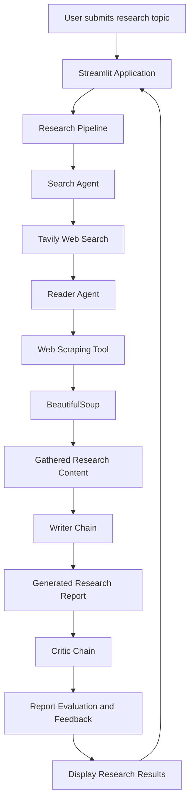
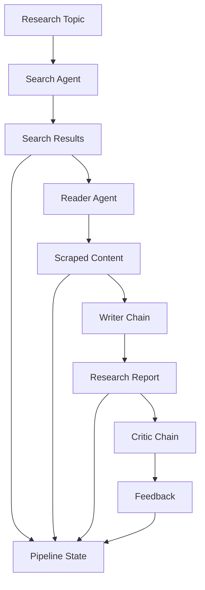

# Deep Research Engine

An AI-powered Multi-Agent Research System that autonomously explores topics, gathers information from multiple web sources, and generates comprehensive research reports using collaborative AI agents.

## Overview

Deep Research Engine is a multi-agent research application built using LangChain, OpenAI, and Tavily.

Instead of relying on a single language model to perform the entire research task, the system divides the process into specialized stages. Each agent or chain is responsible for a particular task, allowing the overall workflow to combine web search, content extraction, report generation, and report evaluation.

The system follows a sequential research pipeline:

1. **Search:** Finds relevant web pages related to the given research topic.
2. **Read:** Extracts useful information from selected web pages.
3. **Write:** Generates a structured research report using the gathered information.
4. **Critique:** Evaluates the generated report and provides feedback.

The application provides a Streamlit-based interface and supports Docker containerization for deployment.

## Table of Contents

- [Technologies & Tools](#technologies--tools)
- [Features](#features)
- [System Architecture](#system-architecture)
- [Research Workflow](#research-workflow)
- [Project Structure](#project-structure)
- [Getting Started](#getting-started)
- [Running with Docker](#running-with-docker)
- [Environment Variables](#environment-variables)
- [Future Improvements](#future-improvements)

## Technologies & Tools

| Category | Technologies / Tools |
|---|---|
| Programming Language | Python |
| LLM Framework | LangChain |
| Language Models | OpenAI Chat Models (`ChatOpenAI`) |
| Agent Development | LangChain Agents |
| Chain Development | LangChain Expression Language (LCEL) |
| Prompt Engineering | `ChatPromptTemplate` |
| Output Processing | `StrOutputParser` |
| Web Search | Tavily |
| Web Scraping | BeautifulSoup |
| HTTP Requests | Requests |
| HTML Parsing | lxml |
| User Interface | Streamlit |
| Containerization | Docker |
| Environment Management | Python Virtual Environments, `python-dotenv` |

## Features

- **Multi-Agent Architecture:** Divides the research process into specialized agents and processing chains.
- **Automated Web Research:** Uses Tavily to search for relevant information on the web.
- **Web Content Extraction:** Uses BeautifulSoup to extract readable content from selected web pages.
- **Automated Report Generation:** Uses an LLM-powered writer chain to generate structured research reports.
- **Report Evaluation:** Uses a critic chain to evaluate the generated report and provide feedback.
- **Streamlit Interface:** Provides an interactive interface for submitting research topics and viewing results.
- **Docker Support:** Containerizes the application for consistent execution and deployment.

## System Architecture

The application consists of four main processing components:

| Component | Responsibility |
|---|---|
| Search Agent | Searches the web for relevant information using Tavily. |
| Reader Agent | Extracts web page content using the web scraping tool. |
| Writer Chain | Generates a research report from the collected information. |
| Critic Chain | Evaluates the generated report and provides feedback. |

### Architecture Diagram



## Research Workflow

The research pipeline coordinates the agents and chains to complete the research task.

### 1. Search Agent

The Search Agent identifies relevant web pages based on the research topic.

- Uses an OpenAI chat model.
- Invokes the `web_search` tool.
- Uses Tavily to retrieve relevant search results.
- Provides URLs and search-result information for the next stage.

### 2. Reader Agent

The Reader Agent extracts information from selected web pages.

- Uses an OpenAI chat model.
- Invokes the `web_scrape` tool.
- Uses Requests to retrieve web page content.
- Uses BeautifulSoup to parse and extract readable text.
- Returns the extracted content for report generation.

### 3. Writer Chain

The Writer Chain generates the research report using the information gathered by the previous stages.

- Uses `ChatPromptTemplate` to structure the input.
- Passes the gathered research content to the language model.
- Uses LangChain Expression Language (LCEL) to connect the prompt, model, and output parser.
- Uses `StrOutputParser` to obtain the generated report as text.

### 4. Critic Chain

The Critic Chain evaluates the generated research report.

- Uses a separate prompt to assess the report.
- Evaluates the generated content and provides feedback.
- Returns the feedback as part of the research pipeline output.

### Pipeline Execution

The overall workflow is orchestrated by `pipeline.py`.



The pipeline maintains a shared state dictionary containing the outputs of each stage:

| State Key | Description |
|---|---|
| `search_results` | Results returned by the Search Agent. |
| `scraped_content` | Content extracted from selected web pages. |
| `report` | Research report generated by the Writer Chain. |
| `feedback` | Evaluation and feedback provided by the Critic Chain. |

The final state contains the outputs produced throughout the research workflow.


## Project Structure

```text
deep-research-engine/
│
├── agents.py
├── tools.py
├── pipeline.py
├── app.py
│
├── requirements.txt
├── Dockerfile
├── .dockerignore
├── .gitignore
│
└── README.md
```

| File | Description |
|---|---|
| `agents.py` | Defines the Search and Reader agents, along with the Writer and Critic chains. |
| `tools.py` | Implements the web search and web scraping tools. |
| `pipeline.py` | Orchestrates the research workflow and coordinates the agents and chains. |
| `app.py` | Provides the Streamlit application interface. |
| `requirements.txt` | Lists the Python dependencies required by the application. |
| `Dockerfile` | Defines the instructions for building the application's Docker image. |
| `.dockerignore` | Specifies files and directories to exclude from the Docker build context. |
| `.gitignore` | Specifies files and directories Git should ignore. |

## Getting Started

### 1. Clone the Repository

```bash
git clone https://github.com/YOUR_USERNAME/deep-research-engine.git
cd deep-research-engine
```

### 2. Create a Virtual Environment

```bash
python -m venv .venv
```

Activate the environment:

**Windows (Command Prompt):**

```bash
.venv\Scripts\activate
```

**Windows (PowerShell):**

```powershell
.\.venv\Scripts\Activate.ps1
```

**macOS / Linux:**

```bash
source .venv/bin/activate
```

### 3. Install Dependencies

```bash
pip install -r requirements.txt
```

### 4. Configure Environment Variables

Create a `.env` file in the root directory and configure the required API keys.

```env
OPENAI_API_KEY=your_openai_api_key
TAVILY_API_KEY=your_tavily_api_key
```

### 5. Run the Application

Start the Streamlit application:

```bash
streamlit run app.py
```

Open the local URL displayed in the terminal, typically:

```text
http://localhost:8501
```

Enter a research topic and run the research pipeline.

## Running with Docker

The application includes a Dockerfile to build and run the system inside a container.

### 1. Build the Docker Image

```bash
docker build -t deep-research-engine .
```

### 2. Run the Container

Pass the required API keys as environment variables:

```bash
docker run -d \
  --name deep-research-engine \
  -p 8501:8501 \
  -e OPENAI_API_KEY=your_openai_api_key \
  -e TAVILY_API_KEY=your_tavily_api_key \
  deep-research-engine
```

On Windows Command Prompt, use a single line:

```cmd
docker run -d --name deep-research-engine -p 8501:8501 -e OPENAI_API_KEY=your_openai_api_key -e TAVILY_API_KEY=your_tavily_api_key deep-research-engine
```

### 3. Access the Application

Open the following URL in your browser:

```text
http://localhost:8501
```

## Environment Variables

The application requires API keys to access external services.

| Environment Variable | Purpose |
|---|---|
| `OPENAI_API_KEY` | Provides access to OpenAI language models. |
| `TAVILY_API_KEY` | Enables web search through the Tavily API. |

**Important:** Never commit actual API keys or `.env` files to GitHub. Use environment variables to provide credentials securely.

## Future Improvements

Potential areas for extending the system include:

- **Iterative Research:** Allow agents to perform additional searches when the gathered information is insufficient.
- **Report Refinement:** Introduce a feedback loop between the Writer and Critic to improve reports based on evaluation results.
- **Source Management:** Collect and display source URLs and references alongside generated reports.
- **Advanced Retrieval:** Explore additional retrieval strategies and information extraction techniques.
- **Agent Orchestration:** Explore LangGraph for more advanced workflows, conditional execution, and state management.
- **Research Evaluation:** Introduce evaluation mechanisms to assess the quality, relevance, and factual accuracy of generated reports.
- **User Experience:** Improve the Streamlit interface with research progress indicators, report downloads, and history management.

---

**Note:** This project is intended to demonstrate how multiple AI agents and processing chains can collaborate to automate a research workflow. It can be extended with additional agents, tools, and orchestration capabilities to support more advanced research applications.
