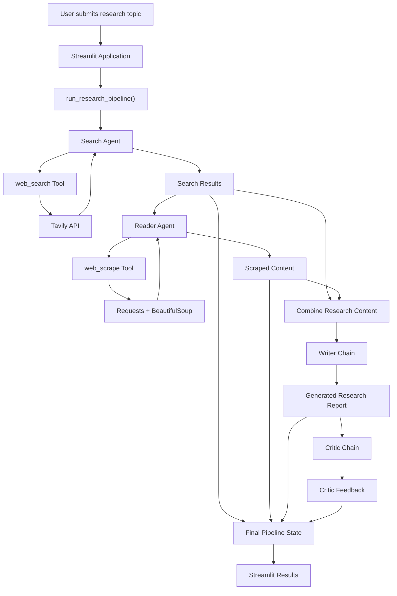
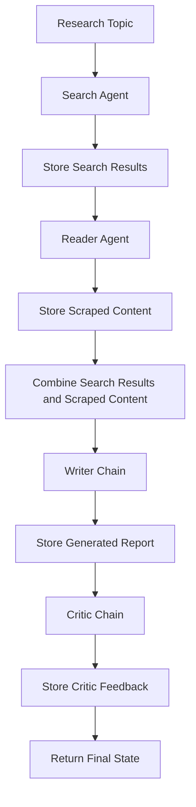

# Deep Research Engine

An AI-powered Multi-Agent Research System that searches the web, extracts relevant information, generates structured research reports, and evaluates them using collaborative AI agents.

## Overview

Deep Research Engine is a multi-agent research application built using Python, LangChain, and OpenAI.

The system divides the research process into four stages:

1. **Search Agent:** Searches the web for recent and relevant information using Tavily.
2. **Reader Agent:** Selects a relevant URL from the search results and extracts its web page content using BeautifulSoup.
3. **Writer Chain:** Combines the search results and extracted content to generate a structured research report.
4. **Critic Chain:** Evaluates the generated report and provides a score, strengths, areas for improvement, and an overall verdict.

The application uses LangChain's `create_agent()` interface for the Search and Reader agents, while the Writer and Critic components are implemented using LangChain Expression Language (LCEL).

A Streamlit interface provides an interactive way to submit research topics, view generated reports, examine critic feedback, and download reports in Markdown format.

The project also includes Docker support for containerizing the application.

## Technologies & Tools

| Category | Technologies / Tools |
|---|---|
| Programming Language | Python |
| LLM Framework | LangChain |
| Language Models | OpenAI Chat Models (`ChatOpenAI`) |
| Agent Development | `create_agent()` |
| Chain Development | LangChain Expression Language (LCEL) |
| Prompt Engineering | `ChatPromptTemplate` |
| Output Processing | `StrOutputParser` |
| Web Search | Tavily |
| Web Scraping | BeautifulSoup |
| HTTP Requests | Requests |
| User Interface | Streamlit |
| Environment Management | `python-dotenv` |
| Containerization | Docker |

## Table of Contents

- [Overview](#overview)
- [Technologies & Tools](#technologies--tools)
- [Features](#features)
- [System Architecture](#system-architecture)
- [Research Workflow](#research-workflow)
- [Project Structure](#project-structure)
- [Getting Started](#getting-started)
- [Running with Docker](#running-with-docker)
- [Environment Variables](#environment-variables)
- [Future Improvements](#future-improvements)

## Features

- **Multi-Agent Architecture:** Uses specialized Search and Reader agents for web research.
- **Automated Web Search:** Retrieves relevant search results using the Tavily API.
- **Web Content Extraction:** Scrapes selected web pages and extracts readable text using BeautifulSoup.
- **Automated Report Generation:** Generates structured research reports using an LLM-powered LCEL chain.
- **Report Evaluation:** Evaluates generated reports and provides scores and constructive feedback.
- **Streamlit Interface:** Provides an interactive interface for submitting research topics and viewing results.
- **Authentication:** Includes a username and password-based login mechanism.
- **Report Download:** Allows users to download generated reports in Markdown format.
- **Docker Support:** Includes a Dockerfile for building and running the application in a container.

## System Architecture

The application consists of four main processing components coordinated by a central research pipeline.

| Component | Implementation | Responsibility |
|---|---|---|
| Search Agent | LangChain `create_agent()` | Searches for relevant web information using the `web_search` tool. |
| Reader Agent | LangChain `create_agent()` | Selects a relevant URL and extracts its content using the `web_scrape` tool. |
| Writer Chain | LCEL | Generates a structured research report from the gathered information. |
| Critic Chain | LCEL | Evaluates the generated report and provides feedback. |

### Architecture Diagram



## Research Workflow

The research pipeline is implemented in `pipeline.py` through the `run_research_pipeline()` function.

### 1. Search Agent

The Search Agent discovers relevant information about the research topic.

- Built using LangChain's `create_agent()` interface.
- Uses an OpenAI chat model.
- Has access to the custom `web_search` tool.
- Uses Tavily to retrieve up to two search results.
- Returns the final search response containing titles, URLs, and content snippets.

**Tool:** `web_search()` in `tools.py`

The tool extracts the title, URL, and first 300 characters of the content from each Tavily search result.

### 2. Reader Agent

The Reader Agent performs deeper reading by selecting a relevant web page from the search results.

- Built using LangChain's `create_agent()` interface.
- Uses the same OpenAI chat model.
- Has access to the custom `web_scrape` tool.
- Receives the first 1,000 characters of the Search Agent's output.
- Decides which URL is most relevant and invokes the scraping tool.

**Tool:** `web_scrape()` in `tools.py`

The scraping tool:

- Sends an HTTP GET request using Requests.
- Parses the HTML using BeautifulSoup.
- Removes `style`, `nav`, `footer`, and `script` elements.
- Extracts readable text from the page.
- Returns up to 3,000 characters of extracted content.

### 3. Writer Chain

The Writer Chain generates a structured research report using the information gathered by the previous stages.

- Implemented using LangChain Expression Language (LCEL).
- Uses `ChatPromptTemplate` to structure the input.
- Receives the research topic and combined research content.
- Passes the formatted prompt to the OpenAI chat model.
- Uses `StrOutputParser` to return the generated report as text.

The generated report follows this structure:

- Introduction
- Key Findings (minimum three well-explained points)
- Conclusion
- Sources

### 4. Critic Chain

The Critic Chain evaluates the report generated by the Writer Chain.

- Implemented using LCEL.
- Uses a separate `ChatPromptTemplate`.
- Receives the generated report as input.
- Evaluates the report and provides a score out of 10.
- Identifies strengths and areas for improvement.
- Provides a one-line verdict.

The Critic Chain returns feedback separately. It does not automatically send the feedback back to the Writer Chain for report revision.

## Pipeline Execution and State Management

The `run_research_pipeline()` function coordinates all four stages and maintains their outputs in a shared Python dictionary named `state`.

The pipeline executes sequentially:



The final state dictionary contains the following keys:

| State Key | Description |
|---|---|
| `search_results` | Final text response returned by the Search Agent. |
| `scraped_content` | Final text response returned by the Reader Agent. |
| `report` | Research report generated by the Writer Chain. |
| `feedback` | Evaluation and feedback returned by the Critic Chain. |

The function returns this dictionary to the calling application.

## Project Structure

```text
deep-research-engine/
│
├── agents.py
├── tools.py
├── pipeline.py
├── app.py
│
├── requirements.txt
├── Dockerfile
├── .dockerignore
├── .gitignore
│
└── README.md
```

| File | Description |
|---|---|
| `agents.py` | Defines the Search and Reader agents, Writer Chain, and Critic Chain. |
| `tools.py` | Implements the Tavily-based web search tool and BeautifulSoup-based web scraping tool. |
| `pipeline.py` | Coordinates the agents and chains, maintains the pipeline state, and returns the final results. |
| `app.py` | Implements the Streamlit interface, authentication, pipeline execution, and result presentation. |
| `requirements.txt` | Lists the Python dependencies required by the application. |
| `Dockerfile` | Contains the instructions for building the application's Docker image. |
| `.dockerignore` | Specifies files and directories excluded from the Docker build context. |
| `.gitignore` | Specifies files and directories Git should ignore. |

## Getting Started

### 1. Clone the Repository

```bash
git clone https://github.com/YOUR_USERNAME/deep-research-engine.git
cd deep-research-engine
```

### 2. Create a Virtual Environment

```bash
python -m venv .venv
```

Activate the environment:

**Windows (Command Prompt):**

```bash
.venv\Scripts\activate
```

**Windows (PowerShell):**

```powershell
.\.venv\Scripts\Activate.ps1
```

**macOS / Linux:**

```bash
source .venv/bin/activate
```

### 3. Install Dependencies

```bash
pip install -r requirements.txt
```

### 4. Configure Environment Variables

Create a `.env` file in the repository root and add the required credentials.

Refer to the [Environment Variables](#environment-variables) section for the complete list.

### 5. Run the Application

```bash
streamlit run app.py
```

Open the local URL displayed in the terminal, typically:

```text
http://localhost:8501
```

Log in using the application credentials configured in your `.env` file.

Enter a research topic and select **Start Research** to execute the pipeline.

## Running with Docker

The repository includes a Dockerfile to build and run the application inside a container.

### 1. Build the Docker Image

```bash
docker build -t deep-research-engine .
```

### 2. Run the Container

If your `.env` file contains all required environment variables, you can pass them to the container using:

```bash
docker run -d \
  --name deep-research-engine \
  --env-file .env \
  -p 8501:8501 \
  deep-research-engine
```

**Windows Command Prompt:**

```cmd
docker run -d --name deep-research-engine --env-file .env -p 8501:8501 deep-research-engine
```

### 3. Access the Application

Open the following URL in your browser:

```text
http://localhost:8501
```

The Dockerfile should configure Streamlit to listen on port `8501` and accept connections from outside the container.

## Environment Variables

The application requires API credentials and application login credentials.

| Environment Variable | Purpose |
|---|---|
| `OPENAI_API_KEY` | Provides access to OpenAI chat models. |
| `TAVILY_API_KEY` | Enables web search through the Tavily API. |
| `APP_USERNAME` | Username required to access the Streamlit application. |
| `APP_PASSWORD` | Password required to access the Streamlit application. |

Example `.env` file:

```env
OPENAI_API_KEY=your_openai_api_key
TAVILY_API_KEY=your_tavily_api_key

APP_USERNAME=your_username
APP_PASSWORD=your_password
```

**Important:**

- Never commit your `.env` file or actual API keys to GitHub.
- Keep your application credentials private.
- Use environment variables to provide credentials securely.
- The application displays whether the OpenAI and Tavily API keys are configured without displaying their actual values.

## Future Improvements

Potential areas for extending the system include:

- **Iterative Research:** Allow agents to perform additional searches when the gathered information is insufficient.
- **Report Refinement:** Introduce a feedback loop between the Writer and Critic to improve reports based on evaluation results.
- **Source Management:** Collect and display source URLs and references alongside generated reports.
- **Advanced Retrieval:** Explore additional retrieval and information extraction techniques.
- **Agent Orchestration:** Explore LangGraph for more customized workflows, conditional execution, and state management.
- **Research Evaluation:** Introduce more comprehensive evaluation mechanisms to assess the relevance, accuracy, and quality of generated reports.
- **User Experience:** Add research history, progress tracking, and additional report export formats.
- **Authentication Improvements:** Introduce more robust user management and per-user access controls.
---

**Note:** This project demonstrates how specialized AI agents and LLM-powered chains can collaborate to automate a research workflow, from web search and content extraction to report generation and evaluation.
